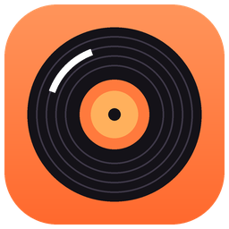
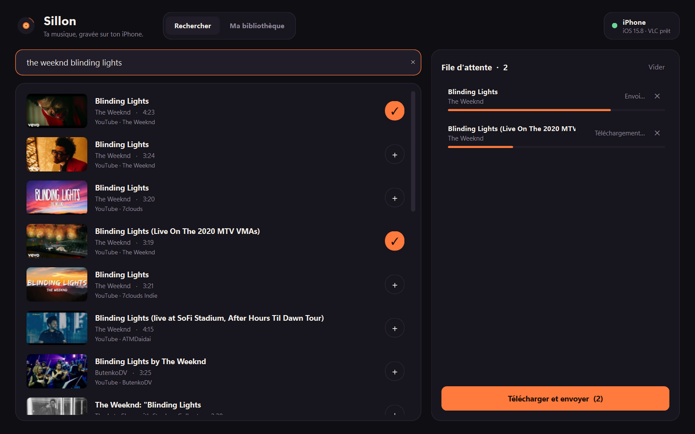
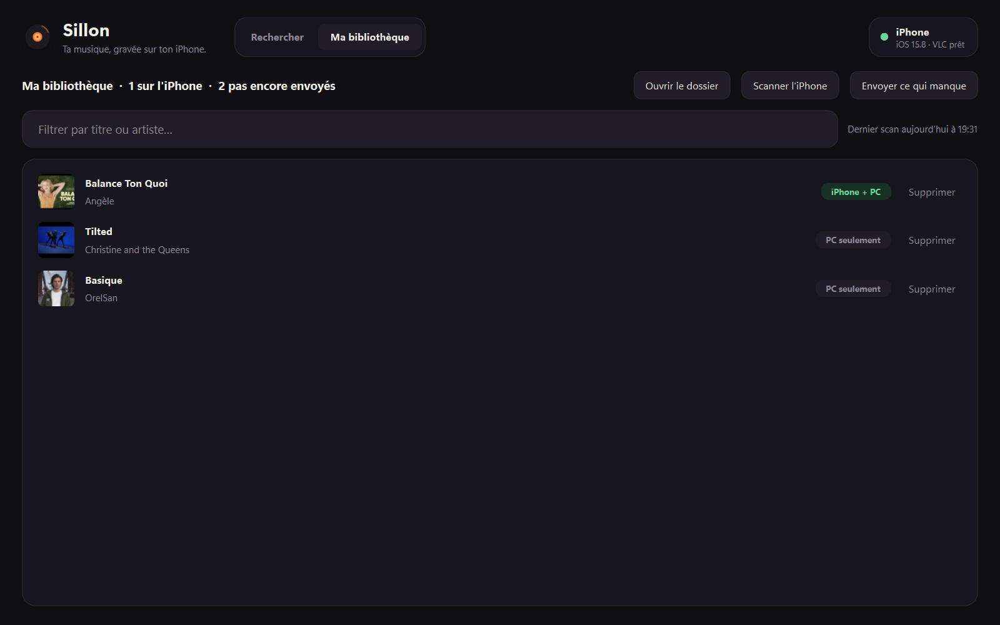
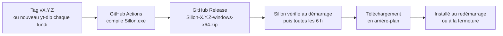

<div align="center">



# Sillon

**Ta musique, gravée sur ton iPhone.**

Cherche un morceau, clique sur **+**, et il arrive dans VLC sur ton iPhone — en M4A, avec titre, artiste et pochette.
Pas d'iTunes Sync, pas de câble à brancher dix fois, pas d'abonnement : la musique est sur le téléphone, hors connexion.

[](https://github.com/Kikoulouche/Sillon/releases/latest)
[](https://github.com/Kikoulouche/Sillon/actions/workflows/ci.yml)
[](#installation)
[](LICENSE)



</div>

## Ce que fait Sillon

| | |
|---|---|
| 🔎 **Recherche** | Tape un titre ou un artiste : résultats YouTube avec miniatures et durées. |
| ⬇️ **Téléchargement M4A** | Audio AAC propre, titre/artiste nettoyés (adieu « (Official Video) »), pochette carrée intégrée. |
| 📱 **Envoi direct dans VLC** | Par USB, directement dans l'app VLC de l'iPhone. Un clic, c'est fini. |
| 🔌 **Synchro auto** | À chaque branchement, les morceaux du PC qui manquent sur l'iPhone y sont envoyés tout seuls. |
| 🗂️ **Scan de l'iPhone** | Dès que l'iPhone est branché, Sillon liste tout ce qu'il y a dans VLC — même ce qui a été envoyé depuis un autre PC — et permet de le supprimer. |
| ♻️ **Anti-doublons** | Un morceau déjà sur le PC ou sur l'iPhone est coché en vert dans la recherche. |
| 🔄 **Mises à jour automatiques** | Sillon se met à jour tout seul depuis GitHub (voir plus bas). |

<div align="center">

</div>

## Installation

**Prérequis**
- Windows 10 ou 11
- [iTunes](https://apps.microsoft.com/detail/9pb2mz1zmb1s) installé (Sillon s'en sert uniquement pour parler à l'iPhone en USB)
- [VLC for Mobile](https://apps.apple.com/app/vlc-for-mobile/id650377962) sur l'iPhone

**Installer Sillon** — dans PowerShell :

```powershell
irm https://raw.githubusercontent.com/Kikoulouche/Sillon/main/install.ps1 | iex
```

Le script télécharge la dernière version dans `%LOCALAPPDATA%\Programs\Sillon` et crée les raccourcis
sur le bureau et dans le menu Démarrer. Tu peux aussi prendre le `.zip` dans les
[Releases](https://github.com/Kikoulouche/Sillon/releases/latest) et lancer `Sillon.exe`.

## Utilisation

1. Branche l'iPhone, déverrouille-le, et la première fois appuie sur **« Se fier à cet ordinateur »**.
2. Le badge en haut à droite passe au vert : **VLC prêt**.
3. Cherche, clique sur **+** pour remplir la file d'attente, puis **Télécharger et envoyer**.
4. Ouvre VLC sur l'iPhone : les morceaux sont dans l'onglet **Audio**.

iPhone pas branché ? Les morceaux restent sur le PC (`Musique\Sillon`) et partent au prochain envoi.

## Mises à jour automatiques



- Au démarrage puis toutes les 6 h, Sillon regarde la dernière [release](https://github.com/Kikoulouche/Sillon/releases).
- Si elle est plus récente, elle est téléchargée en silence ; un bandeau **« Sillon X.Y.Z est prête — Redémarrer »** apparaît.
  Si tu ne cliques pas, elle s'installe simplement quand tu fermes l'app.
- **YouTube change souvent** et seul yt-dlp suit le rythme : chaque lundi, une GitHub Action vérifie si une nouvelle
  version de yt-dlp est sortie et, si oui, publie automatiquement une nouvelle version de Sillon. Rien à faire de ton côté.
- Tes musiques, ton historique et le cache de l'iPhone ne sont jamais dans le dossier du programme : une mise à jour n'y touche pas.

## Où sont mes fichiers ?

| Quoi | Où |
|---|---|
| Musiques téléchargées | `%USERPROFILE%\Music\Sillon` |
| Programme | `%LOCALAPPDATA%\Programs\Sillon` |
| Cache du scan iPhone, journal | `%LOCALAPPDATA%\Sillon` |
| Musiques sur l'iPhone | App VLC → dossier *Documents* |

## Développement

```powershell
git clone https://github.com/Kikoulouche/Sillon.git
cd Sillon
python -m venv .venv
.venv\Scripts\pip install -r requirements.txt pytest ruff pyinstaller
.venv\Scripts\python Sillon.pyw        # lancer depuis le code
.venv\Scripts\pytest -q                # tests
.venv\Scripts\ruff check .             # lint
.\tools\build.ps1                      # compiler dist\Sillon + zip
```

**Publier une version** : mettre à jour `CHANGELOG.md`, puis

```powershell
git tag v1.1.0; git push origin v1.1.0
```

La GitHub Action compile, teste l'exécutable (`Sillon.exe --selftest`) et publie la release ; toutes les installations
se mettent à jour d'elles-mêmes.

**Architecture**

```
sillon/
├── core.py      recherche (yt-dlp), téléchargement M4A, tags + pochette (mutagen, Pillow), historique
├── iphone.py    connexion USB (pymobiledevice3), envoi / scan / suppression dans VLC (house_arrest + AFC)
├── updater.py   vérification et installation des mises à jour depuis GitHub Releases
└── app.py       interface PySide6
```

## Avertissement

Sillon est un outil personnel. Télécharger du contenu depuis YouTube peut aller à l'encontre de ses conditions
d'utilisation et du droit d'auteur selon ton pays : n'utilise Sillon que pour de la musique que tu as le droit de copier,
pour ton usage privé. Sillon n'est affilié ni à YouTube, ni à Apple, ni à VideoLAN.

## Licence

[MIT](LICENSE)
